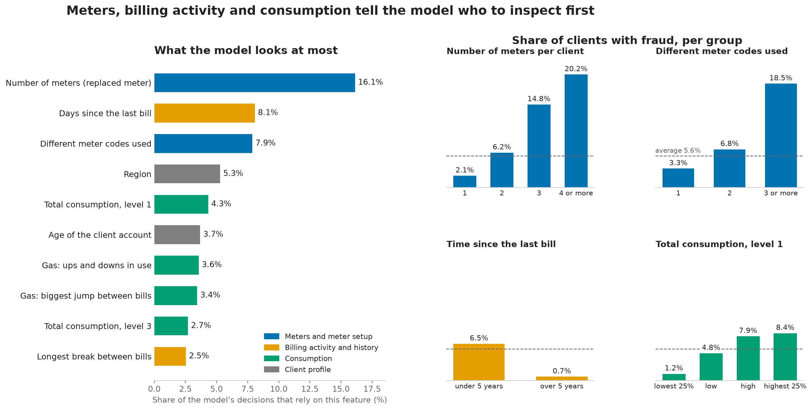

# EDA Summary

Details and charts: [03_eda-analysis.ipynb](03_eda-analysis.ipynb). Gas vs electricity: [04_hypotheses-gas-vs-elec.ipynb](04_hypotheses-gas-vs-elec.ipynb). Hypotheses: [hypotheses.md](hypotheses.md). Team decisions: [protocol.md](protocol.md).

## The data in short
- **135,493 clients** in train. Only **5.6%** are fraud, so the data is imbalanced. Accuracy would be misleading, so our main metric is ROC-AUC (see [protocol.md](protocol.md)). PR-AUC, precision, recall and F1 are reported next to it.
- The invoice table has about **4.5 million bills**, around 30 per client. The model needs **one row per client**, so we must summarize the bills into features.
- Every bill belongs to a known client, and every client has bills. Joining loses nobody.

## Main findings
1. **Client category 51** has **16.9%** fraud (vs 5.5% for category 11) and is the strongest signal. It holds for clients with any number of bills.
2. **Number of bills:** the more bills a client has, the more often they are fraud (1.3% for 1 to 10 bills, 9.0% for 51 or more). It also explains part of other effects, so we always compare clients with a similar number of bills.
3. **Negative index difference** (the meter reading goes backward): **11.3%** fraud vs 5.5%, about twice as high. Rare (1,816 clients), but strong.
4. **Outliers point to fraud:** the fraud rate rises with the client's biggest bill (2.6% up to 1,000, then 6.7%, 11.4%, 13.2% for 10,000 to 50,000). We keep the outliers. Above 50,000 it drops to 3.8%, probably errors.
5. **Unsteady consumption:** fraud clients have bigger jumps between bills (median 1,530 vs 930) and more variation. This holds in every bill group.
6. **Region** matters: 103 (10.3%) and 311 (8.0%) are high, 101 (3.6%) and 301 (3.3%) are low.
7. **Tariff type:** plans 40 (7.7%) and 10 (6.8%) are above average, plan 11 (84% of clients) is below. **But** tariff 40 only exists on gas bills and its 7.1% on gas equals the gas average, so that part is a meter effect (07). On electricity tariff 10 (7.3%) is above 11 (5.4%).
8. **Gas vs electricity (07):** region and client category give the same result on both meters. Sudden change, index mismatch and outliers are mainly an **electricity** signal (for example mismatch 9.2% vs 5.5% on ELEC, 7.9% vs 7.1% on GAZ). Gas clients have a higher average (7.2% vs 5.6%). Many gas results rest on small groups.
9. **Column check, consumption levels:** we checked if we can delete the four `consommation_level` columns. We keep them: clients whose bills are all in level 1 are rarely fraud (**1.7%** vs 6.9%), also for clients with similar total consumption, so the levels carry information the total does not.

## What the final model really uses (for the presentation)

*Status: 2026-10-23. Written for readers without a data science background. The EDA findings above are the starting point. This section shows what the final model actually uses and how it differs from the plan.*

### In short
- **The task:** STEG can only inspect a limited number of homes. Our model gives every client a **fraud risk score** and builds a **priority list**: who to visit first.
- **The input:** for every client we summarize the bills (about 30 per client) into **39 numbers** (we call them *features*), for example "how many meters", "how long since the last bill", "how much consumption".
- **How good is the list?** Our quality score is **ROC-AUC**. Pick one real fraud client and one honest client at random: the model puts the fraud client higher on the list in about **88 out of 100 cases** (0.876 in our cross-validation, **0.874** on the Zindi test set; 0.5 would be a coin flip, our first simple model reached 0.76).
- **The data:** 135,493 clients, only 5.6% of them are fraud (about 1 in 18).

### What the model looks at most

*Left: how much the model relies on each feature (share of the total, in %). Right: share of clients with fraud for four of them; the dashed line is the 5.6% average. Code and numbers: [15_feature-importance-story.ipynb](15_feature-importance-story.ipynb).*

### The four strongest signals in plain words
1. **Number of meters (most important, 16% of the model's decisions).** Clients with one meter are fraud in 2.1% of cases, with two meters 6.2%, with three 14.8% and with four or more **20.2%**. A meter that was replaced can be a sign of tampering. It can also be STEG's reaction after it already found fraud (see caveat below).
2. **Time since the last bill (8%).** Clients whose last bill is more than 5 years old are almost never fraud (**0.7%** vs 6.5%). These are probably closed accounts that nobody inspects, so nobody finds fraud there.
3. **Variety in the meter setup (8%).** Clients that use **three or more different meter codes** are fraud in **18.5%** of cases, clients with one code in only 3.3%. We found this by studying the fraud cases the model missed earlier.
4. **Consumption (several features, 3 to 4% each).** The more a client consumed in total, the higher the fraud rate (1.2% for the lowest quarter, **8.4%** for the highest quarter). This is the signal our first EDA found, but it is weaker than the three above.

**Region** (5% of the model's decisions) also matters, as our EDA showed (fraud rates from 3% to 10% between regions).

### The plan versus the result

| EDA finding (above) | What happened in the model |
|---|---|
| Client category 51, number of bills, tariff type | Kept. They help, but are **not** among the 12 most important features |
| Region | Kept, 4th most important |
| Meter reading goes backward | **Dropped.** The model hardly used it (0.02% of its decisions together with one more column) |
| Unsteady consumption, outliers, consumption levels | Kept, as the consumption features. The "biggest bill per level" columns were dropped (no loss in score) |
| Not planned: number of meters, variety of the meter setup, time since the last bill, client age, gaps between bills | **Added later, and they brought the biggest gain.** Each step was tested on the same data splits. Score (ROC-AUC, validation) 0.77 with the EDA features, 0.86 after time and meter features, **0.88** after the variety features |

Lesson for the presentation: the EDA told us where to look, but the best signals (meters, activity, variety) only showed up when we looked at **how the meter setup and the billing history of a client change**, not only at how much a client consumes.

### Be careful with the two strongest signals
- **Number of meters** and **time since the last bill** may partly show **what STEG did after it found fraud** (replace the meter, stop visiting a closed account), not what the client did before. Our data has no date of detection, so we cannot prove it either way.
- Both help our score on the Zindi test set, because it has the same pattern. For STEG in daily use, the model would mostly say "look at clients with several meters and do not inspect closed accounts". **We should ask STEG** how these two columns come about.
- The variety features use `reading_remarque` (a reading remark code). On 2026-10-20 the team decided not to use this column as a feature. Feature set v3 changes that, see [protocol.md](protocol.md).
- All numbers are links in the data, **not proof of cause**.

Details: [11_feature-selection.ipynb](11_feature-selection.ipynb), [13_diversity-features.ipynb](13_diversity-features.ipynb), [14_final-model-submission.ipynb](14_final-model-submission.ipynb).

## Features to keep for the model

*Plan from before the modelling (feature set v1). The final feature list is described in the section above and saved in `models/selected_features_v3.json`.*

| Feature | Hypothesis | How to build it (per client) | Why |
|---|---|---|---|
| `client_catg` | 8 | as category | Strongest signal, holds for any bill count |
| `n_bills` | none (bill count check) | number of bills | Fraud rate rises from 1.3% to 9.0% |
| `region` | 1 | as category | Clear differences between big regions |
| `has_backward`, `backward_count` | 6 | bills where `new_index < old_index` | Twice the fraud rate |
| `max_consumption`, median and mean consumption | 7 | max, median, mean of the total consumption per bill | Fraud rate rises with the biggest bill. Do not cap. |
| `consommation_level_1` to `consommation_level_4` | none (column check) | the four original columns, aggregated per client as sum and max (biggest single bill per level). No mean (it is sum / `n_bills`). No new level features. | Clients with all bills level-1-only are fraud only 1.7% (vs 6.9%), also inside each consumption group, so the levels add information beyond the total. Do not drop the level columns. |
| `max_change`, `std_cons` | 2 | biggest jump between bills within one meter, and std. Also per meter (`_elec`, `_gaz`), keep only if validation improves | Fraud clients are less steady, mainly on electricity |
| `tarif_type` | 4 | most common plan, rare plans grouped as "other" | Plan 10 is above average on electricity. Plan 40 only reflects the gas meter. |

Also from `protocol.md`: when summarizing bills, use **median and max** besides the mean, and use a log transform for the logistic regression baseline.

## Not worth keeping
- **`client_id`:** only an ID. Keep it just to join the tables and for the submission.

- **Meter setup (ELEC, GAZ or both):** tested in Hypothesis 9 of the notebook. It looked risky (7.2% vs 4.2%), but with a similar number of bills there is no difference.

Per-meter features are an addition, not a replacement: we do not split region, client category or meter setup by meter (team decision, see `protocol.md`).

Ideas we looked at earlier, not in the notebook (see "Dropped" in `hypotheses.md`):
- **Zero or very low consumption:** tested on the raw data, no support (zero-consumption share 10.7% for fraud vs 12.8% for no fraud).

## Be careful with
- **Small groups** (rare regions, rare tariffs) look extreme by chance. Do not trust them.
- **Leakage:** only train has `target`. Anything learned from the target (for example grouping regions by fraud rate) must be learned on the training split only, after the validation split.
- Build the features for **train and test** in the same way, so the columns match.
- These are links, not proof of cause. A feature that looks good here still has to prove itself in the baseline model.

## Still to check
- Why clients with rollover bills have more fraud (heavy use?).
- ~~Biggest consumption **drop**, `months_number`, gaps between bills, client age from `creation_date`.~~ Done in [11_feature-selection.ipynb](11_feature-selection.ipynb): biggest drop did not help, `months_number`, gaps and client age are in the final model.

Several of these checks came from our data analyst agent (see the review notes in `hypotheses.md`).
